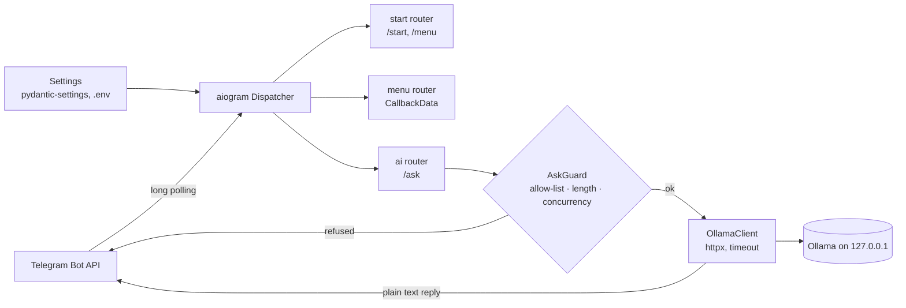

# telegram-bot-starter

[](https://github.com/HOFFMAN-ALTERNATIVE/telegram-bot-starter/actions/workflows/ci.yml)


A small, typed starting point for async Telegram bots on aiogram 3, with an optional
`/ask` command backed by a local Ollama model. Clone it, set a token, add routers. The
`/ask` path is bounded out of the box (allow-list, prompt cap, per-user and global
concurrency limits), so a public bot cannot be used to burn your GPU.

- aiogram 3 with one `Router` per feature; settings, the LLM client and the guard are
  injected into handlers
- Typed config via `pydantic-settings`, validated at startup; the token is a `SecretStr`
- Inline-keyboard menu with typed `CallbackData`
- Optional local LLM chat through Ollama, no cloud API keys
- Docker and Compose: non-root, read-only filesystem, all capabilities dropped
- CI: ruff, mypy, pytest (8 tests, LLM mocked) and `pip-audit`

The trade-off: it is deliberately small. No database, no webhook mode, no i18n. Those
are the first things a real bot adds, and the router layout keeps them easy to bolt on.

## How it works



## Quick start

```bash
git clone https://github.com/HOFFMAN-ALTERNATIVE/telegram-bot-starter.git
cd telegram-bot-starter
cp .env.example .env            # put your BOT_TOKEN from @BotFather

python -m venv .venv && . .venv/bin/activate
pip install -e ".[dev]"
python -m bot
```

With Docker:

```bash
docker compose up -d --build
```

### Enable local AI (optional)

```bash
ollama pull llama3.2:3b
# .env
OLLAMA_MODEL=llama3.2:3b
OLLAMA_URL=http://127.0.0.1:11434   # in Docker: http://host.docker.internal:11434
```

Keep the Ollama API bound to `127.0.0.1`; it has no authentication. If the bot is
public, set `ASK_ALLOWED_USER_IDS` (for example `[123456789]`). The bot logs a warning
at startup when `/ask` is open to everyone.

| Setting | Default | Meaning |
|---|---|---|
| `ASK_ALLOWED_USER_IDS` | `[]` (anyone) | JSON list of Telegram user IDs allowed to use `/ask` |
| `ASK_MAX_PROMPT_CHARS` | `2000` | longer questions are refused (1-4000) |
| `ASK_MAX_CONCURRENT` | `2` | LLM requests in flight across all users (1-32) |
| `OLLAMA_TIMEOUT` | `120` | seconds before an LLM call is abandoned |

## Structure

```
bot/
  __main__.py      entry point: Bot, Dispatcher, DI, polling, cleanup on shutdown
  config.py        pydantic-settings
  guard.py         /ask allow-list, prompt cap, per-user and global concurrency
  keyboards.py     inline keyboards + CallbackData
  llm.py           async Ollama client
  handlers/
    start.py       /start, /menu
    menu.py        inline menu navigation
    ai.py          /ask, local LLM
tests/             pytest (settings, keyboards, routers, guard, mocked LLM)
docs/adr/          design decisions
```

Add a feature: create `bot/handlers/<feature>.py` with its own `Router`, then include it
in `bot/handlers/__init__.py`.

## Design decisions

- [ADR 0001](docs/adr/0001-long-polling-over-webhooks.md): long polling, not webhooks.
  No public endpoint, TLS or reverse proxy needed; one process only.
- [ADR 0002](docs/adr/0002-local-llm-behind-a-guard.md): local Ollama behind an
  in-process guard instead of a cloud API. No keys and no data leaving the host; the
  guard state is per process.

## Limits

- Long polling only, one process. The guard's in-flight tracking lives in memory, so
  running two replicas doubles the effective limits.
- `/ask` sends no conversation history; each question is answered on its own.
- No persistence. Restarting the bot forgets everything.
- No Docker `HEALTHCHECK`: a polling bot exposes no port. Compose restarts it if the
  process exits; add a heartbeat file or a `/healthz` sidecar if you need liveness
  beyond that.

## Development

```bash
ruff check . && ruff format --check . && mypy bot --ignore-missing-imports && pytest -q
```

Security notes: [SECURITY.md](SECURITY.md).

## Container image

Multi-arch (amd64/arm64) images are published to GitHub Container Registry on every release:

```bash
docker pull ghcr.io/hoffman-alternative/telegram-bot-starter:latest
```

## License

MIT, see [LICENSE](LICENSE).
